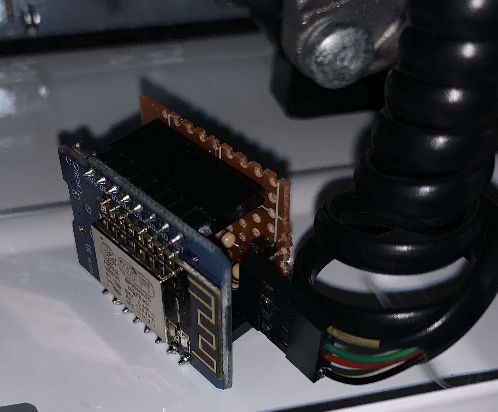
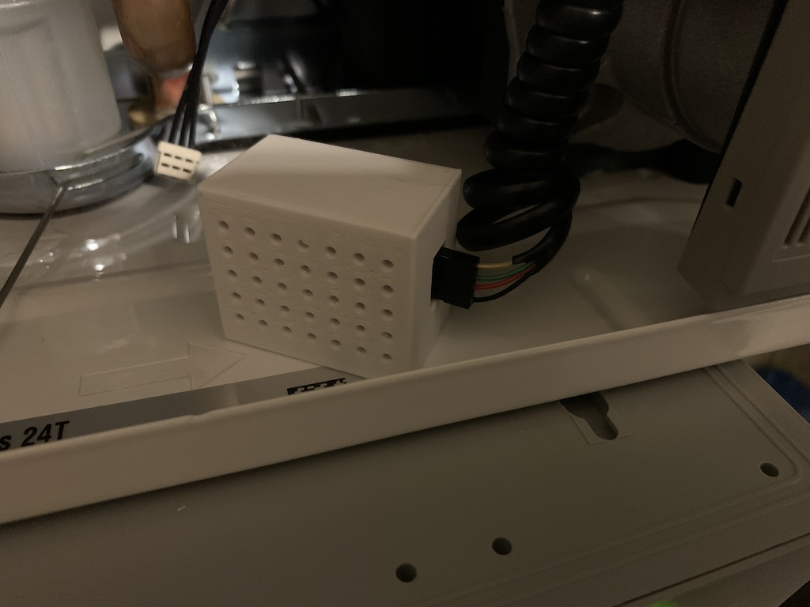
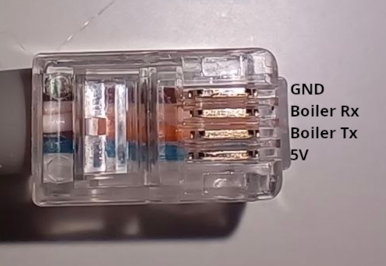

# Dietrich (Remeha) Boiler connectivity using ESP8266 / ESP32 with ESPHOME

Native ESPHome **external component** for reading data from De Dietrich (or Remeha) PC interface, tested with model mcr3.
Works on both **ESP8266** (e.g. Wemos D1) and **ESP32** (e.g. DevKit V4) boards with ESPHOME software - sample YAML files are in English and Polish.

## Usage

Since ESPHome 2025.2 the old `platform: custom` + `includes:` mechanism is removed, so this
project is now a proper external component. Add it to your YAML:

```yaml
external_components:
  - source: github://kakaki/esphome_dietrich
    components: [ dietrich ]

uart:
  id: uart_bus
  baud_rate: 9600
  tx_pin: GPIO1
  rx_pin: GPIO3

dietrich:
  uart_id: uart_bus
  update_interval: 15s
  # variant: calenta_v1_p5   # for Calenta / MCX Plus / Avanta V1_P5 (default: mcr3)
  flow_temp:
    name: "Boiler flow temp"
  # ... see the example YAML files for the full sensor list
```

Full examples:

| File | Board | Language | Protocol variant |
|---|---|---|---|
| [dietrich_en.yaml](dietrich_en.yaml) | ESP8266 | English | `mcr3` (default) |
| [dietrich_pl.yaml](dietrich_pl.yaml) | ESP8266 | Polish | `mcr3` (default) |
| [dietrich_calenta_v1_p5_en.yaml](dietrich_calenta_v1_p5_en.yaml) | ESP8266 | English | `calenta_v1_p5` |
| [dietrich_calenta_v1_p5_pl.yaml](dietrich_calenta_v1_p5_pl.yaml) | ESP8266 | Polish | `calenta_v1_p5` |
| [dietrich_esp32_en.yaml](dietrich_esp32_en.yaml) | ESP32 | English | `mcr3` (default) |
| [dietrich_emc_m_en.yaml](dietrich_emc_m_en.yaml) | ESP8266 (GPIO2/GPIO14) | English | `mcr3`, De Dietrich EMC-M 24/28 MI |

### ESP32 notes

The component works on ESP32 as well (verified with an ESP32 DevKit V4 /
`az-delivery-devkit-v4`), but do **not** copy the ESP8266 UART/logger settings:

- keep the `logger:` on its default UART0/USB console — `hardware_uart: UART1`
  would map to GPIO9/GPIO10, which are wired to the internal SPI flash on classic
  ESP32 modules and crash the board in a boot loop (this was the cause of issue #7),
- put the boiler bus on free pins, e.g. UART2: `tx_pin: GPIO17`, `rx_pin: GPIO16`.

The component source lives in [components/dietrich](components/dietrich). Compared to the
legacy custom component it also validates every response frame with CRC16 (`mcr3` variant)
before publishing any values.

The legacy header files `dietrich.h` and `dietrich_calentaV1_P5.h` are kept for users of
ESPHome ≤ 2025.1 with the old `platform: custom` mechanism.

## Hardware

The ESP connects to the boiler's PC/service port, a 4P4C (RJ10) connector with four signals: **GND**, **5V**, **TX** and **RX** (3.3 V/5 V TTL serial, 9600 baud). The pin order is **not the same on every boiler**. RX and TX in particular are swapped on some models, so find your boiler's pinout first and then wire the ESP. Two working setups are shown under [Connection examples](#connection-examples).

### Finding the boiler pinout

You need a multimeter, the ESP8266 board, a USB cable and Remeha's **Recom** service software.

**1. Find GND and 5V.** With the boiler powered on, measure the DC voltage between the pins of the boiler connector (or the wires of your cable). The pair that reads about **+5 V** gives you **GND** (black probe) and **5V** (red probe). These are normally the two outer pins. The two remaining pins are TX and RX. Both can idle near 5 V or 3.3 V, so you can't tell them apart with a multimeter.

**2. Turn the ESP board into a USB-serial adapter.** Connect the board's `RST` pin to `GND`. This holds the ESP chip in reset, so the board's USB-serial chip (CH340, CP2102, FTDI, …) talks directly to its `TX`/`RX` pins. Plug the board into the PC and note its COM port (Device Manager → Ports). The board does not need any firmware for this.

**3. Connect the boiler.** Connect the boiler's **GND** to the board's `GND`. Leave **5V** unconnected, since USB powers the board. Connect the two remaining wires to the board's `TX` and `RX` pins, either way round for now.

**4. Find TX and RX with Recom.** Open Recom, select the board's COM port and connect.

- If Recom identifies the boiler (for example an EMC-M 24/28 MI shows up as `PCU-05 (P2)`), the wiring is right. The wire on the board's **`TX`** pin is the **boiler TX**, and the wire on the board's **`RX`** pin is the **boiler RX**.
- If Recom finds nothing, close it, swap the two data wires and try again.

In this mode the wiring is *straight* (TX → TX, RX → RX) because the pin labels are from the USB chip's point of view. Its TX output is on the pin labelled `RX`, which is wired to the ESP's own RX.

**5. (Optional) Find the protocol variant.** Close Recom and, with the same wiring, run:

```
pip install pyserial
python tools/detect_protocol.py COM3
```

It sends the `mcr3` and `calenta_v1_p5` requests, shows which one the boiler answers, and decodes a few values so you can compare them with Recom. Use the answering one as `variant:` in the YAML.

**6. Wire the ESP for ESPHome.** Remove the `RST`–`GND` link and *cross* the data lines, so the ESP's TX goes to the boiler's RX:

| Boiler | ESP |
| --- | --- |
| GND | GND |
| TX | ESP RX pin (`rx_pin`) |
| RX | ESP TX pin (`tx_pin`) |
| 5V | 5V (or unconnected when the ESP is powered over USB) |

On the ESP8266 you can use either the hardware UART (GPIO1/GPIO3) or any two free pins such as GPIO4/GPIO5 (software serial, fine at 9600 baud). The hardware pins are shared with the board's USB-serial chip. With USB plugged in, that chip overrides the boiler's reply on GPIO3, so the ESP sends requests but never gets an answer. If the ESP stays connected to USB, use GPIO4/GPIO5.

### Connection examples

#### De Dietrich MCR3 (original setup)

Wired to the hardware UART (GPIO1/GPIO3), with ESPHome's logs moved to `UART1`. See [dietrich_en.yaml](dietrich_en.yaml).

```
 Heater Board from top       ESP8266 / ESP32
    4P4C RJ connector

       +---------+
GND 4  ---       +--+        GND
TXD 3  ---          |        RX
RXD 2  ---          |        TX
5V  1  ---       +--+        5V
       +---------+
```

I have connected ESP to prototype board with pins, on board there was simple voltage divider (1kΩ / 2kΩ) to change power from 5V to 3V, but on my board it was not needed and i have connected pins directly to Dietich MCR33, .
Cable is simple phone cord, cut and added pin connector to it.

Screenshot of board connected to boiler.



And in printed box.



#### De Dietrich EMC-M 24/28 MI

Recom shows this boiler's control board as `PCU-05 (P2)`. It answers the **`mcr3`** protocol and does not respond to `calenta_v1_p5`. **RX and TX are swapped compared with the MCR3 example:** the pin next to GND is the boiler's RX, not its TX. The ESP stays powered over USB, so the boiler is on D4/D5 (GPIO2/GPIO14), which also leaves D1/D2/D6/D7 free for an OpenTherm gateway such as the DIYless one. See [dietrich_emc_m_en.yaml](dietrich_emc_m_en.yaml).



| Plug position (top → bottom in the photo) | Boiler signal | ESP8266 pin |
| --- | --- | --- |
| 1 | GND | GND |
| 2 | RX | D4 / GPIO2 (`tx_pin`) |
| 3 | TX | D5 / GPIO14 (`rx_pin`) |
| 4 | 5V | not connected (ESP powered over USB) |

```yaml
logger:            # stays on USB, the boiler is not on GPIO1/GPIO3

uart:
  id: uart_bus
  baud_rate: 9600
  tx_pin: GPIO2    # D4 -> boiler RX
  rx_pin: GPIO14   # D5 <- boiler TX

dietrich:
  uart_id: uart_bus
  update_interval: 5s
  variant: mcr3
```

This boiler has no outside, calorifier or DHW-in sensors, and no electronic water pressure sensor. Those values come back as placeholders (−32 °C, −172 °C, 0 bar), so leave those sensors out of the configuration.

## License

This project is licensed under the [GNU General Public License v3.0](LICENSE).
GPL-3.0 is used to ensure any derivative work remains open source.

## Credits

Thanks to great work from https://github.com/rjblake/remeha - for creating maping of data in excel file.

The rewrite of the original custom component into a native ESPHome external component
(the C++ and Python code in [components/dietrich](components/dietrich), including CRC16
frame validation and the `calenta_v1_p5` variant support) was done with the help of
Claude (Anthropic), based on the original protocol logic in this repository.
